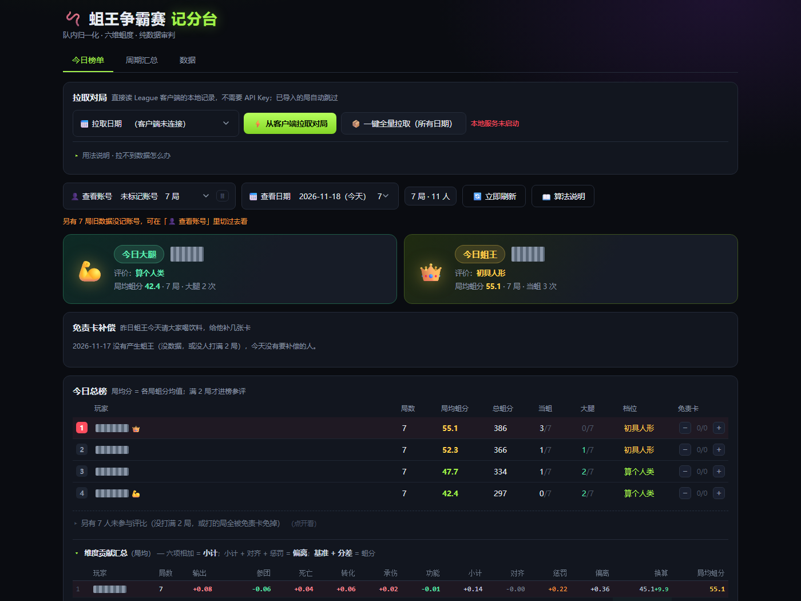
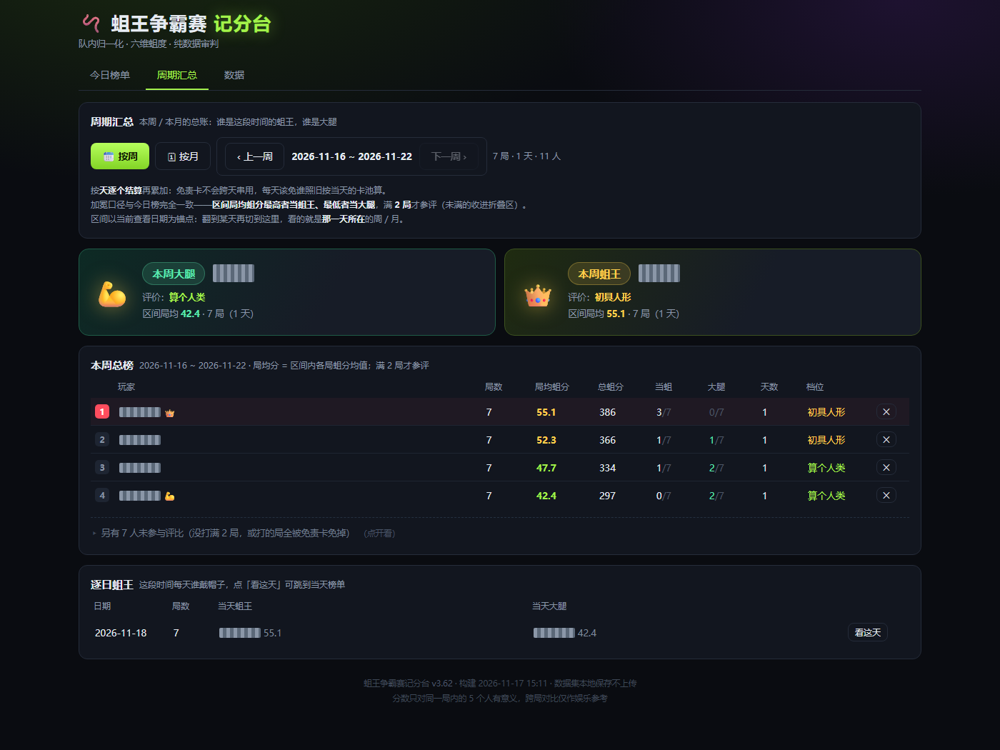
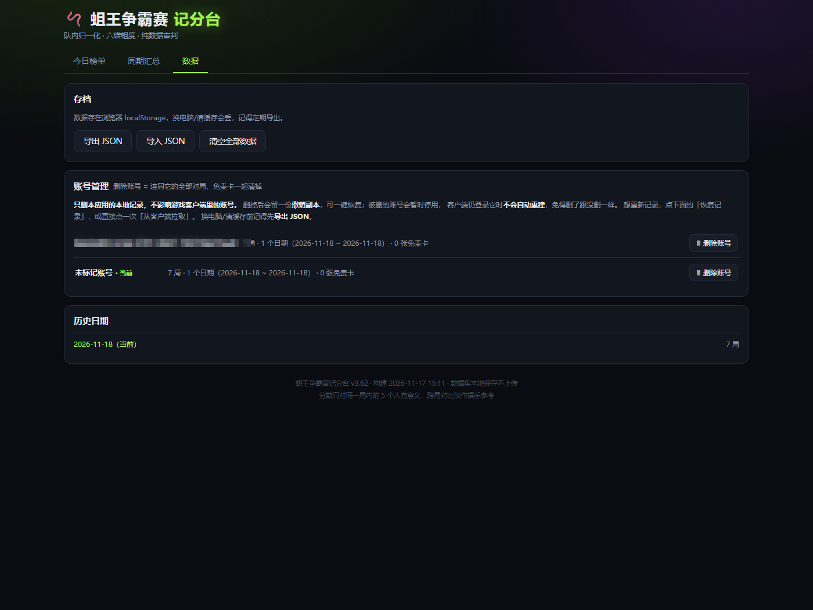

# 蛆王争霸赛 · 记分台

一个**非官方**的本地记分小工具：读取本机英雄联盟客户端已产生的对局记录，按自定规则算分、评比、发"免责卡"，并做周 / 月战绩汇总。纯本地运行，无联网上传。

> **当前仅支持「海克斯大乱斗」娱乐模式**（Arena / 斗魂竞技场类的娱乐对局）。评分算法、锚点与六维权重都是针对该模式调校的，召唤师峡谷等其它模式的对局不在适配范围内，拉取后分数不保证合理。

> **免责声明**：本项目为玩家自娱乐的粉丝作品，与 Riot Games、腾讯、拳头游戏无任何隶属、授权或背书关系。项目不含上述公司的商标图案、角色立绘、音频或其他受版权保护的素材；代码中出现的 `League of Legends` / `英雄联盟` / `Riot Games` / `Tencent` / `WeGame` 字样仅用于**识别本机客户端安装目录**，属描述性使用。请遵守你所使用游戏的服务条款。作者不对使用本工具产生的任何后果负责。

## 它能做什么

- 客户端开着就能拉取最近对局，按召唤师名记录每局得分与排名。
- 自定义评分锚点与惩罚规则，按人均分评当日"蛆王"与"大腿"。
- 免责卡：手动发放，可让指定玩家当局不计最蛆，并影响当日总榜。
- 周期汇总：按周 / 月翻页查看，可剔除指定玩家，不改动原始对局。
- 多账号分区：同一台电脑多个召唤师账号的数据彼此隔离。

## 截图展示

> 下图为演示数据（人名为假名、PUUID 已打码、分数为示例），仅展示界面布局，不代表真实战绩。







## 数据与安全

- 所有战绩、卡片、账号数据只存在**本机浏览器 WebView2 的 localStorage** 中（桌面版持久化目录：`%LOCALAPPDATA%\QuWangScoreboard`）。
- 程序只通过本机回环地址 `127.0.0.1` 读取客户端自身开放的本地接口（LCU），**不修改游戏文件、不注入进程内存、不模拟操作、不读取他人账号、不向外部服务器发送任何对局数据**。
- 仓库中**不含任何真实战绩、召唤师昵称或凭据**。LCU 口令在运行时从本机客户端临时读取，不写死在代码里。
- 换电脑、清缓存或重装系统会丢数据，请定期用内置导出功能备份。

## 运行环境

- Windows 10 / 11（依赖 Edge WebView2 运行时，Win11 自带；Win10 若缺失请装 [WebView2 Runtime](https://developer.microsoft.com/microsoft-edge/webview2/)）。
- Python 3.10+（仅源码运行时需要；直接下载 exe 不需要）。
- 英雄联盟客户端处于运行状态（登录到大厅即可，无需开局）。

## 用法

**方式一：直接运行 exe（推荐普通用户）**

仓库根目录已附带 `蛆王争霸赛.exe`（约 19 MB），下载后双击即可，无需安装 Python。首次运行若被 Windows Defender / 杀软误报，属 PyInstaller 单文件打包的常见现象，可自行选择放行。启动后点托盘图标可显示 / 隐藏窗口，右键托盘可退出。

> exe 与源码同步更新；若你改动了源码，请用下面的命令重新打包。

**方式二：源码运行**

```bash
pip install pywebview pystray pillow
python app.py
```

**自己打包 exe**（在项目根目录执行）：

```bash
pyinstaller --noconfirm --onefile --windowed ^
    --name 蛆王争霸赛 ^
    --add-data "蛆王争霸赛.html;." ^
    --add-data "本地服务.py;." ^
    --add-data "客户端拉取.py;." ^
    app.py
```

产物在 `dist/`。打包需另外安装 `pyinstaller`。

## 目录结构

```
蛆王争霸赛.exe       已打包好的成品，双击运行（普通用户只需这个文件）
app.py              桌面入口：窗口、托盘、给网页调用的后端方法
本地服务.py          本地 HTTP 服务 / 配置 / 成绩计算相关
客户端拉取.py        定位客户端、读取 LCU 凭据与对局历史
蛆王争霸赛.html       全部前端界面与记分逻辑（单文件）
LICENSES/           第三方依赖的许可证原文
```

## 第三方依赖与许可证

本项目自身为私人作品，未选择开源许可证（保留所有权利）；但打包时包含下列第三方库，其许可证原文见 `LICENSES/`：

| 组件 | 版本 | 许可证 | 备注 |
| --- | --- | --- | --- |
| pywebview | 6.2.1 | BSD-3-Clause | 窗口与 WebView2 桥接 |
| pystray | 0.19.5 | LGPLv3 | 系统托盘；打包分发时请留意 LGPL 的附加义务 |
| Pillow | 13.0.0 | MIT-CMU | 托盘图标与战报图 |
| PyInstaller | 6.22.3 | GPLv2 + 打包例外 | 仅打包阶段使用，例外条款允许打包闭源程序 |

详见 `LICENSES/INDEX.md`。若你重新分发 exe，请一并保留许可证文本。

## 已知事项

- 客户端路径自动探测对国服（WeGame / 腾讯游戏目录）和外服都做了兼容；探测失败时可在程序里手动指定安装目录。
- LCU 是非官方接口，游戏客户端更新可能导致拉取功能临时失效，属正常现象。
- 本工具不会、也不能绕过游戏反作弊；它不接触游戏进程内存。
